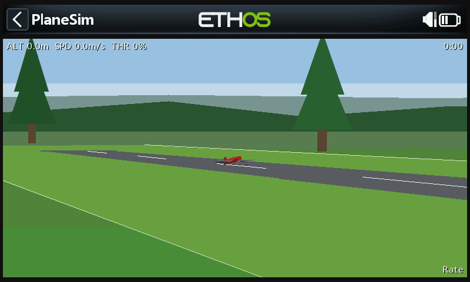
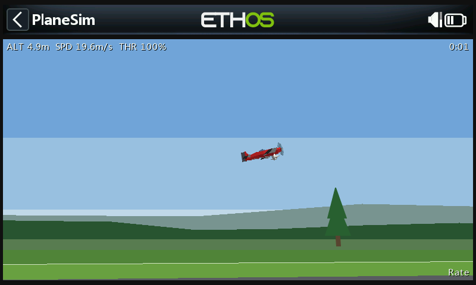
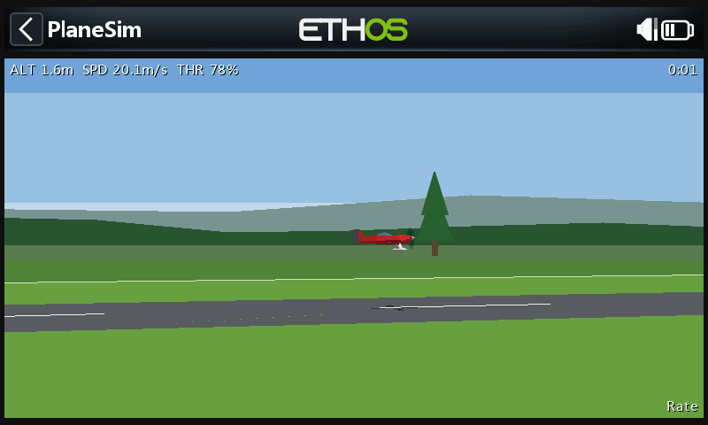
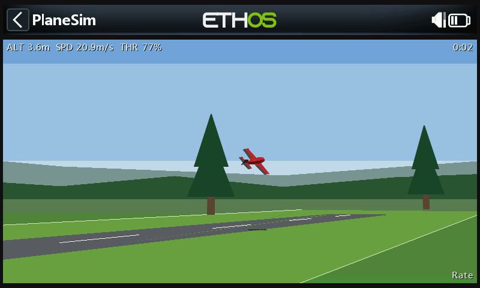

# PlaneSim

A 3D RC aeroplane flight simulator for FrSky Ethos radios, flown with the radio's own sticks.

| On the runway | Climb-out |
| --- | --- |
|  |  |
| **Low pass** | **Banked pass** |
|  |  |

*Screenshots from the Ethos simulator (X20S).*

You stand at the edge of a flying field with a runway in front, and the view turns to follow the plane, as when flying a real one. The model is the low-poly Extra-style aerobatic plane from wingflight-lua-ethos-suite (`app/plane3d.lua`, a copy of the Wingflight Configurator's model), at a 2 m span. Its ailerons, elevator and rudder move with the sticks, and the prop blurs into a disc under power. The wings and tailplane are white underneath, so upright and inverted are easy to tell apart. A shadow on the ground shows height.

The sim is built the same way as [heli-sim](https://github.com/robthomson/heli-sim): same renderer, tooling and performance approach.

## Flying

PlaneSim runs on the whole screen, without the title bar. The flight data, flight mode and flight time sit on a black bar at the top.

- The plane starts at the west end of the runway, pointing east (to the right). Lower the throttle to arm the motor.
- Throttle up to roll. The tail comes up with speed, and up elevator holds it down. The rudder steers on the ground. The plane lifts off at about 15 m/s.
- **Rate** (default): the sticks set roll, pitch and yaw rates, like a stabilised receiver in rate mode. Control authority fades as the airspeed drops, but prop wash keeps the elevator and rudder working, so the plane can hover on the prop.
- **Self-level**: aileron and elevator set the bank and pitch angles, and centre stick levels the wings.
- The wing stalls at about 15 degrees angle of attack, and the nose then drops as the plane weathervanes into the airflow.
- Land on the wheels, gently and wings level. Hitting a wing tip, the prop, the nose or the fin is a crash, as is landing too hard or sliding sideways.

| Key | Action |
| --- | --- |
| Enter | Back to the runway |
| Page | Settings |
| Rotary | Zoom |
| Exit | Close the tool |

Settings (saved to `planesim.cfg` next to the script):

| Setting | Default | Range |
| --- | --- | --- |
| Flight mode | Rate | Rate, Self-level |
| Roll rate | 360 deg/s | 30–1000 |
| Pitch rate | 240 deg/s | 30–1000 |
| Yaw rate | 180 deg/s | 30–1000 |
| Expo | 30% | 0–90% |
| Response | Crisp | Soft, Normal, Crisp, Locked in (how fast the rates follow the sticks) |
| Auto zoom | On | |
| Detail | Low | Low, High (see Performance) |
| Show CPU stats | Off | |

The rates are at full airspeed; they shrink when the plane is slow. Stick sources are the analog sticks by function (`CATEGORY_ANALOG` members 0–3: rudder, elevator, throttle, aileron), so the stick mode does not matter.

## Layout

- `src/planesim/main.lua`: registers the system tool
- `src/planesim/sim.lua`: app state, sticks, settings, HUD
- `src/planesim/lib/physics.lua`: flight model (lift, stall, drag, thrust, prop wash, stability, ground roll, contact)
- `src/planesim/lib/plane.lua`: the plane mesh (about 90 faces, built in stages), control surface and prop animation
- `src/planesim/lib/render.lua`: camera, scenery, projection, display lists
- `tools/headless.py`: runs the sim headless with scripted sticks, counts Lua instructions per callback, saves frames as PNG
- `tools/make_icon.py`: draws `gfx/icon.png` from the mesh

## Performance

Ethos aborts a `paint` that runs about 20000 Lua instructions; `wakeup` is not held to that budget (measured in the Ethos simulator). So `wakeup` does all the work into flat display lists and `paint` only replays them, using 10–15% of its budget. When the plane is small on screen, the canopy, spinner, gear and prop are left out. Beyond 15 m one scale serves the whole model (the perspective inside it would move its outline by 1-2 px). When nothing has moved, the frame is not rebuilt or repainted. A new frame invalidates rectangles only: a plain `lcd.invalidate()` makes Ethos clear the window first. The HUD text sits on opaque bars outside the scene, so it is drawn without a shadow and only every other frame; in between only the scene's rectangle is invalidated and Ethos keeps the bars. The hot loops keep their display lists in locals (indexing an upvalue costs an extra VM instruction per access). The plane is drawn where it is at the moment of the frame (the time not yet stepped is carried forward), so fast passes do not stutter.

On a radio both the Lua work and the `lcd` fills cost frame time, and the **Detail** setting trades scenery for speed:

- **Low** (default): the hills and tree line are flat bands, there is no mown strip under the runway (nor its edge lines), the shadow is two triangles, and the low detail model is used until the plane is close.
- **High**: hill and tree line silhouettes, the mown strip, a cross-shaped shadow and the full model from about 20 m.

## VS Code deploy

- `Deploy & Launch [SIM]`
- `Deploy Radio`, `Deploy Radio [Fast]`
- `Deploy Radio + Serial Debug`

The simulator target comes from the Ethos extension settings in `.vscode/settings.json` (`ethos.board`, `ethos.protocol`, `ethos.release`, `ethos.simulatorsFolder`). The scripts go to `simulators/<BOARD>_<PROTOCOL>@<release>/scripts/planesim`.

## Headless testing

```text
pip install lupa pillow
python tools/headless.py --scenario takeoff --frames 40,120
python tools/headless.py --scenario loop --seconds 15
python tools/headless.py --scenario stall --seconds 15
```

The script prints position, attitude, airspeed and instruction counts, and writes frames to `tools/out/`. Its paint counts include the Lua stand-ins for `lcd` calls, so they are higher than on a radio.
